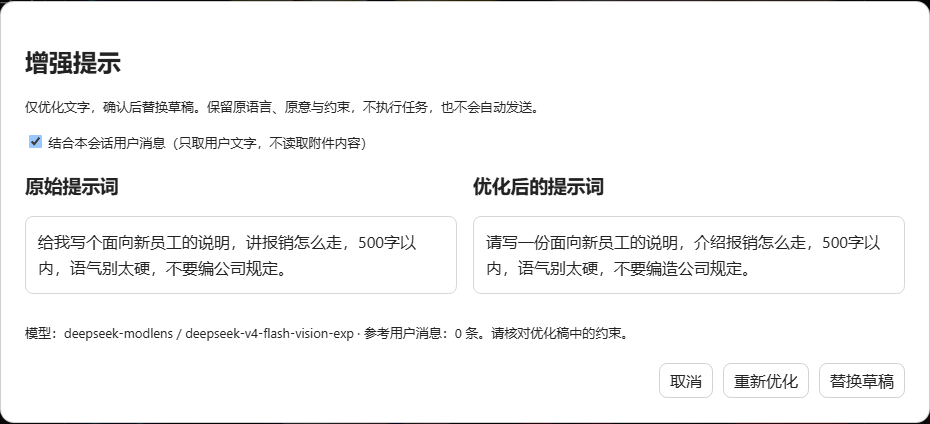

# V1.2 DSH 验证记录

验证日期：2026-10-11。DSH CLI、ui-conversation、llm 和 host-apiproxy 版本均为 **0.1.0-rc.6**；本机 Windows 11，Node 24.19.0。插件通过 `dsh plugin --profile web add link:...` 安装；随后使用构建好的 `.tgz` 通过同一管理器正式安装；实际原生 DSH 服务在 `127.0.0.1:3080` 启动。

## 自动化测试

`dsh-prompt-enhancer/` 执行 `npm test`：**10/10 通过**。测试包括草稿 revision / session / phase / reference 保护、图片不变、不发送、输入限额、同源检查与 DNS rebinding 拒绝、用户上下文筛选且不静默截断、异常和截断输出拒绝、真实 HTTP handler 的选中模型参数及空工具列表、未知会话 / 大请求、错误信息不回显凭据、重复请求拒绝和浏览器断开后中止模型流。

独立代码审查发现 DSH `BlockAssembler.finish` 在无 finish chunk 时默认返回 stop，会错误接受未完成输出。新增回归测试先失败（200 ≠ 400），随后加入显式完成标记检查，最终 10 项全部通过。独立复审通过，没有遗留的必修问题。

## 实际浏览器验证

浏览器使用隔离的 Playwright Chromium，访问实际已安装插件的 DSH Web 页面。系统 Chrome 未启用调试连接，因此没有操控用户现有浏览器或草稿。

- 原生输入框内出现「增强提示」，空草稿禁用，输入示例后启用。
- 实际选中路由 `deepseek-modlens / deepseek-v4-flash-vision-exp` 完成一次真实模型编辑，HTTP 200，返回保留中文、500 字限制和“不编公司规定”的优化稿。
- 预览前后原始草稿保持一致，确认替换后通过 DSH 公开输入动作写回；没有 `session.prompt` / `session.command` 请求，也没有页面 JS 错误。
- 另用可控响应夹具验证：收到优化稿后通过原生 textarea input 事件修改草稿，「替换草稿」禁用并提示已修改；取消后新草稿保留；请求期间取消不会被迟到结果重新打开；Esc 关闭预览且不改草稿。这些竞态用例不调用真实模型。
- 实际确认预览截图见下方；截图仅含测试文本与模型路由，没有侧栏会话或本机路径。

## 安装及范围

配置改动限 DSH Web profile：追加插件依赖与 bundle 条目，由原生插件管理器维护 lockfile。安装前在本地工作目录备份既有 profile 文件，未发布这些文件。原有 Codex 全局 AGENTS.md 和已安装 prompt-optimizer/SKILL.md 的 SHA256 前后完全一致，仓库内 Skill 文件无改动。Claude Code / WorkBuddy 配置未修改。

发布安装包已在全新、隔离的 DSH_HOME / web profile 通过 `.tgz` 安装并成功启动到 3081，前端加载无 JS 错误；随后本机正式 profile 也改用该安装包。隔离 profile 无模型凭据，不重复进行模型调用。附件下载校验值见本次发布的 SHA256SUMS.txt。

## 边界

仅本机 Web rc.6 实测。不宣称 Electron、远程代理、子智能体会话或其他 DSH 版本通过。文件/技能芯片草稿明确禁用；图片保留但不读取其内容。长上下文拒绝而非截断。没有用不可验证的“100% 语义不变”承诺替代预览；保持原意和约束仍由编辑指令、用户核对及原文共同保证。
